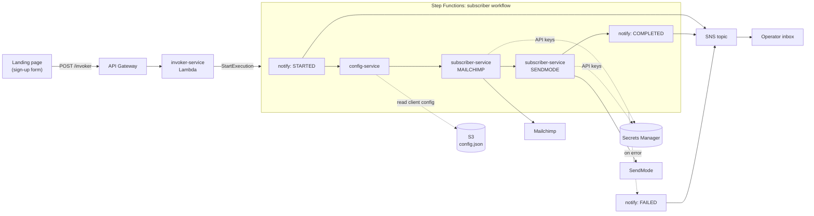

# EnterpriseService_v2

**A low-cost, event-driven marketing platform for small businesses, built on AWS serverless services.**

Small businesses want the same things larger companies get from marketing software, such as campaigns, company updates and personalised birthday messages. They rarely have the budget for expensive marketing platforms. EnterpriseService_v2 is a prototype that offers those features as event-driven workflows on AWS Lambda and Step Functions. It costs almost nothing when idle and grows with usage, and one deployment can serve several businesses.

> **Status:** Prototype, not currently deployed. It was piloted with a real customer, Acme Beauty ([see below](#pilot-acme-beauty)), and is now kept as a portfolio project and base for further development.

---

## Table of contents

- [Why this exists](#why-this-exists)
- [Features](#features)
- [Architecture](#architecture)
- [How a sign-up flows through the system](#how-a-sign-up-flows-through-the-system)
- [Key concepts](#key-concepts)
- [Tech stack](#tech-stack)
- [Repository structure](#repository-structure)
- [Getting started](#getting-started)
- [Deploying and operating a workflow](#deploying-and-operating-a-workflow)
- [Pilot: Acme Beauty](#pilot-acme-beauty)
- [Roadmap](#roadmap)

---

## Why this exists

Marketing tools for small businesses tend to fall into two groups:

- **All-in-one platforms** that charge monthly fees whether or not you use them, and that tie customer data and channels to one vendor.
- **Doing it by hand**: spreadsheets, copy-pasting contacts between tools, and remembering to send birthday messages.

This project takes a third approach. It is a thin, event-driven layer that a business owns and that connects to the channels it already uses:

- **Pay per use.** Every component is serverless (API Gateway, Lambda, Step Functions, SNS, S3, Secrets Manager), so an idle deployment costs close to nothing.
- **Built around events.** Something happens, such as a customer signing up, a campaign launching or a birthday arriving. A workflow then runs the steps needed to act on it across one or more channels.
- **Several businesses per deployment.** Each business ("client") has its own config and credentials, so one deployment can serve many small businesses.
- **Swappable channels.** The first version supports Mailchimp (email) and SendMode (SMS). Channels are kept in separate modules so the platform doesn't lock clients into one vendor.

The first use case was **personalised birthday campaigns**. A customer signs up with their birthday and is added to the business's email and SMS audiences. The business can then send them birthday offers automatically.

## Features

- Public REST endpoint for collecting sign-ups from any web form.
- Step Functions workflow that runs each sign-up from start to finish, with retries and failure handling.
- **Mailchimp** integration: adds the subscriber to the client's audience, with first name, surname, phone number and birthday as merge fields.
- **SendMode** integration: adds the subscriber to the client's SMS group.
- Email notifications through SNS when a workflow starts, completes or fails.
- Per-client configuration in S3, with API keys kept in AWS Secrets Manager.
- Isolated, named deployments ("workflows") for each environment, all provisioned with Terraform.
- A shell-script toolchain to build, provision, configure and destroy a workflow.
- Demo landing pages that can be hosted on S3.

## Architecture



| Component | Type | Responsibility |
| --- | --- | --- |
| `invoker-service` | Lambda | Receives the API request, starts the Step Functions run, and returns `200` straight away. |
| `config-service` | Lambda | Loads the requesting client's settings (secret name, Mailchimp audience, SendMode group) from S3. |
| `subscriber-service` | Lambda | Adds the subscriber to a marketing channel. The `action` field (`MAILCHIMP` or `SENDMODE`) chooses which one. |
| `notification-service` | Lambda | Formats an event and publishes it to the workflow's SNS email topic. |
| Subscriber workflow | Step Functions | Runs the steps in order, retries failed channel calls, and sends a failure notification on error. |

## How a sign-up flows through the system

1. **Capture.** A visitor submits the landing-page form. The page adds its client identifier (`company`) and POSTs JSON to the workflow's API:

   ```json
   {
     "company": "acme_beauty",
     "fname": "Jane",
     "lname": "Doe",
     "email": "jane@example.com",
     "mobile_number": "0871234567",
     "birthday": "21/04"
   }
   ```

2. **Hand-off.** `invoker-service` starts a run of the state machine with that payload and replies to the browser at once. The user never waits for third-party APIs.
3. **Notify start.** The workflow sends a "STARTED" email to the operator.
4. **Load client config.** `config-service` reads `subscriber-workflow/<workflow_name>/config/config.json` from S3 and returns the entry for `company`.
5. **Email channel.** `subscriber-service` gets the client's Mailchimp key from Secrets Manager and adds the subscriber to the configured audience.
6. **SMS channel.** `subscriber-service` gets the client's SendMode key and adds the subscriber to the configured group.
7. **Notify result.** The operator gets a "COMPLETED" email. If any step fails, the workflow sends a "FAILED" email with the subscriber's details instead, so nothing is silently lost.

## Key concepts

### Workflows (environments)

A **workflow** is one isolated deployment of the whole stack, identified by a `workflow_name` (for example `qa-v5-wf`). Workflows are used as environments such as dev, QA and production. Each one gets its own resources:

- Lambdas named `<workflow_name>-<service>`
- An API Gateway called `<workflow_name>-<version>-optin-api`
- A Step Functions state machine called `<workflow_name>-marketing-optin-wf`
- An SNS email topic
- Terraform state at `s3://<code_bucket>/<workflow_type>/<workflow_name>/terraform/state/`

`subscriber` is currently the only workflow type, but the scripts and folder layout (`workflows/<type>-workflow/`) are designed for more.

### Clients (businesses)

One workflow can serve several businesses. Each client has:

- **An entry in the workflow's `config.json` in S3** saying which channel audiences or groups to use:

  ```json
  {
    "acme_beauty": {
      "aws_store": "<workflow_name>/subscriber/acme_beauty",
      "mailchimp": { "audience_id": "<audience id>" },
      "sendmode":  { "group_id": "<group id>" }
    }
  }
  ```

- **A Secrets Manager secret** (`<workflow_name>/subscriber/<company>`) holding its Mailchimp and SendMode API keys. Lambda IAM policies only allow reading secrets under the workflow's own prefix.

`scripts/deployments/add-client-config.sh` creates both in one step.

### Shared modules

Code that more than one Lambda uses is kept in `modules/` as small installable Python packages:

| Module | Package | Purpose |
| --- | --- | --- |
| `utils` | `c_logger` | Consistent logging set-up |
| `aws_utils` | `aws_utilities` | S3 and Secrets Manager helpers |
| `mailchimp_service` | `mail_chimp` | Mailchimp Marketing API client and audience management |
| `sendmode_service` | `sendmode_client` | SendMode REST client and opt-in import |

Each Lambda's `package.sh` lists the modules it depends on. At build time those modules are built as wheels, installed into the Lambda's `build/` folder, and zipped into `deployment_package.zip`. Packages that the Lambda runtime already provides, such as `boto3`, are left out.

## Tech stack

- **AWS:** API Gateway, Lambda (Python 3.8), Step Functions, SNS, S3, Secrets Manager, IAM
- **Infrastructure as code:** Terraform 0.11, with remote state in S3
- **Languages:** Python, Bash, plus HTML/CSS/JS for the demo pages
- **Integrations:** Mailchimp Marketing API, SendMode REST API
- **CI:** GitHub Actions (early stage)

## Repository structure

```text
.
├── aws-components/lambda/      # Lambda handlers, one folder per service, each with a package.sh
│   ├── config-service/
│   ├── invoker-service/
│   ├── notification-service/
│   └── subscriber-service/
├── modules/                    # Shared Python packages bundled into the Lambdas
├── terraform/
│   ├── base/                   # Reusable building blocks (lambda, sns, secrets, backend templates)
│   ├── lambda/                 # One module per Lambda: function, IAM role and policy, env vars
│   ├── api_gateway/            # REST API for sign-ups, with CORS
│   └── secret_manager/
├── workflows/
│   └── subscriber-workflow/    # Root Terraform for a workflow, state machine template, config
├── scripts/
│   ├── common/                 # Shared bash helpers and the config update tool
│   └── deployments/            # build / provision / destroy / add-client-config
├── web/                        # Demo landing pages and a reusable form script template
├── .github/workflows/          # CI pipelines
├── .terraform-version          # Terraform version for tfenv
└── project.version             # Version stamped onto deployed resources
```

## Getting started

### Prerequisites

| Tool | Version | Used for |
| --- | --- | --- |
| Bash, `git`, `curl`, `zip`, `unzip` | any recent | Build and deploy scripts |
| Python 3 + `virtualenv` | 3.8 (matches CI and the Lambda runtime) | Building the Lambda packages |
| `boto3` (system Python) | any recent | `scripts/common/config_update.py` |
| [tfenv](https://github.com/tfutils/tfenv) | latest | Installing the pinned Terraform version |
| Terraform | `0.11.14` (pinned in `.terraform-version`) | Provisioning infrastructure |
| AWS CLI | v2 | S3 uploads, Secrets Manager, Terraform credentials |
| An AWS account | — | Access keys with permission to create the resources above |
| Mailchimp and SendMode accounts | — | API keys and audience/group IDs for each client |

Development is done on Linux. The commands below are for Debian/Ubuntu; on other distributions install the same tools with your package manager.

### 1. Clone the repository

The scripts work out the project root from the current path, so the checkout folder **must be named `EnterpriseService_v2`**, and scripts must be run from inside it.

```bash
git clone <repo-url> EnterpriseService_v2
cd EnterpriseService_v2
```

### 2. Install system packages

```bash
sudo apt-get update
sudo apt-get install -y git curl zip unzip python3 python3-pip python3-virtualenv python3-boto3
```

### 3. Install Terraform with tfenv

tfenv reads `.terraform-version` in the repo root and installs that version.

```bash
git clone --depth=1 https://github.com/tfutils/tfenv.git ~/.tfenv
echo 'export PATH="$HOME/.tfenv/bin:$PATH"' >> ~/.bashrc
source ~/.bashrc

# From the repo root
tfenv install
tfenv use
terraform -version   # should report v0.11.14
```

When upgrading Terraform, update both `.terraform-version` and `terraform_version` in `.github/workflows/terraform.yml`.

### 4. Install and configure the AWS CLI

```bash
curl "https://awscli.amazonaws.com/awscli-exe-linux-x86_64.zip" -o awscliv2.zip
unzip awscliv2.zip
sudo ./aws/install
rm -rf aws awscliv2.zip

aws configure   # enter your access key, secret key, and region (eu-west-1)
```

### 5. Python virtual environment

You don't need to create this yourself. The build scripts create and activate `venv_dep/` in the repo root on first run (see `scripts/common/utils.sh`).

## Deploying and operating a workflow

Run all commands from the repo root. Run any script with no arguments to see its full list of options.

### 1. Provision a workflow

This builds every Lambda package, uploads the workflow's starting `config.json` to S3, writes the Terraform backend config, and runs `terraform apply`.

```bash
./scripts/deployments/provision-workflow.sh \
  --workflow_type subscriber \
  --workflow_name <name> \
  --code_bucket <bucket>
```

Optional flags: `--aws_region` (default `eu-west-1`), `--version` (default from `project.version`), and `--state_bucket s3|local`.

### 2. Subscribe to notifications

The workflow publishes start, success and failure events to an SNS topic called `<workflow_name>-email`. For now you subscribe an email address yourself, either in the AWS console or with the CLI:

```bash
aws sns subscribe --topic-arn <topic-arn> --protocol email --notification-endpoint you@example.com
```

### 3. Onboard a client

```bash
./scripts/deployments/add-client-config.sh \
  --workflow_type subscriber \
  --workflow_name <name> \
  --company_name <company> \
  --mailchimp_audience_id <audience-id> \
  --sendmode_group <group-id> \
  --code_bucket <bucket>
```

The script asks for the Mailchimp and SendMode API keys and hides what you type. For non-interactive use, set `MAILCHIMP_KEY` and `SENDMODE_KEY` in the environment instead. The keys are never passed as arguments or printed, and they reach AWS through a temporary file that only you can read.

### 4. Point a landing page at the API

Copy `web/templates/scripts/comms.js` into your page. Set `COMPANY_NAME` to the client key and `APIGW_URL` to the workflow's `/invoker` endpoint. The page can be hosted as a static site on S3.

### 5. Build a single component

```bash
./scripts/deployments/build.sh --component <service-name>   # e.g. config-service
```

### 6. Tear down a workflow

This destroys the workflow's infrastructure and deletes its client secrets.

```bash
./scripts/deployments/destroy-workflow.sh \
  --workflow_type subscriber \
  --workflow_name <name> \
  --code_bucket <bucket>
```

## Pilot: Acme Beauty

The platform was piloted with **Acme Beauty**, a small beauty retailer, to run a **birthday campaign**. Customers signed up on a landing page (see `web/acme_beauty` and `web/acme_beauty_2`) with their name, contact details and birthday. Each sign-up added them to Acme Beauty's Mailchimp audience and SendMode SMS group, ready for birthday offers by email and text.

The pilot showed that the end-to-end flow works for a real business at a running cost of almost nothing. Acme Beauty used it for a short period after the initial deployment.

## Roadmap

The prototype covers one event type (sign-up) and two channels. Planned next steps:

- **More event types:** campaign sends, company update broadcasts, and scheduled personalised messages such as birthdays. Some of these exist in a separate codebase that will be merged into this one.
- **An open set of channels:** add new email and SMS providers, plus other channel types, through a common provider interface, so clients aren't tied to Mailchimp or SendMode.
- **Automated notification set-up:** create SNS subscriptions as part of provisioning instead of by hand.
- **CI/CD:** build out GitHub Actions to test, build and deploy workflows to each environment.
- **Modernise the toolchain:** upgrade from Terraform 0.11 and Python 3.8 to current versions.
- **Self-service onboarding:** add clients without running scripts by hand.

---

*Built by Kyle Truebody.*
